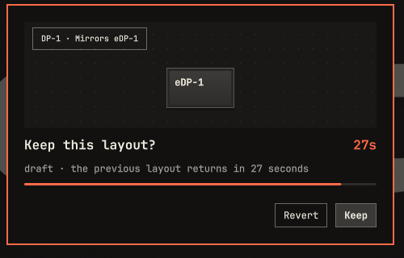
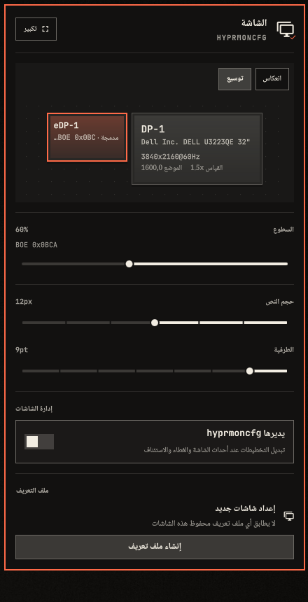

# hyprmoncfg panel 2.12.0

The panel loads again on stable Omarchy, speaks every Omarchy language, and gains one-click Extend and Mirror. Requires hyprmoncfg 1.24.0 or newer; [1.27.0](https://github.com/crmne/hyprmoncfg/releases/tag/v1.27.0) adds Omarchy display panel compatibility.

Install or update through Omarchy's plugin manager: [hyprmoncfg panel](https://github.com/crmne/omarchy-hyprmoncfg).

*Real panel in real Quickshell with synthetic monitors, in an isolated display.*

## New

- **Your language, everywhere.** The panel follows Omarchy's language live in all 50 languages, including right-to-left ones, where the layout mirrors and your monitors stay in their physical positions. Older Omarchy stays in English. Translations have not had native-speaker review, so corrections are very welcome.
- **One-click Extend and Mirror.** With a built-in display and an external one, switch from the layout. It uses the normal Keep and Revert preview, and `m` does the same on the expanded Layout page.
- **Right-click to rotate.** Right-click a display for Normal, 90°, 180° and 270°, plus Auto where it is supported.
- **h/j/k/l work like the arrows.** `Ctrl` and `Alt` versions move a display on the canvas. `Shift+h/j/k/l` stays the 500px jump, and `l` on Profiles stays Load.
- **A simpler view with one display.** Controls that do nothing without a second display are gone. Rotation is still there.

## Fixed

- **The panel loads on Omarchy 4.0.6 again.** 2.11.0 used shell features that release does not have, so the bar icon and preview service failed to load. Reported by @M0VO and diagnosed by @ghostdogpr in [#44](https://github.com/crmne/omarchy-hyprmoncfg/issues/44). If you pinned 2.10.1 as a workaround, you can update now.
- **The preview service loads on the next Omarchy release.** Omarchy removed a component it relied on.
- **New sequential plans start in groups of three**, and a group size you chose survives switching strategy.
- **Expand no longer jumps** from a screen-tall frame to the panel's real size.
- **The selected display shows its plain name** under Brightness.

## Known limitations

- Extend restores earlier display positions from memory for the current session, so a shell restart loses them.
- Daemon messages stay in English, as do the bar widget's name and setting.
- On Hyprland 0.57 and later, the confirmation card may blink once after a monitor moves.
- Renaming a profile is in hyprmoncfg 1.27.0's CLI and TUI, and is still to come in the panel.

## What's tested

All 276 Node tests and the 25 and 34 QML suite totals pass, along with qmllint and plugin validation. The panel ran in real Quickshell with the real Omarchy shell from both 4.0.6 and the current development branch, with no plugin QML errors. Those runs used a real `hyprmoncfgd` in an isolated nested Hyprland, with simulated monitors for multi-display states, and exercised the bar icon, compact and expanded views, Mirror with Revert, the rotate menu, keyboard moves and live language switching. This release does not claim tests on real displays, a real mirror or rotation, Hyprland 0.57, or the Keep action.

## Thanks

Thanks to @M0VO for reporting the 4.0.6 failure, and @ghostdogpr for the logs and workaround that pinned it down.

**Full changelog**: https://github.com/crmne/omarchy-hyprmoncfg/compare/v2.11.0...v2.12.0
