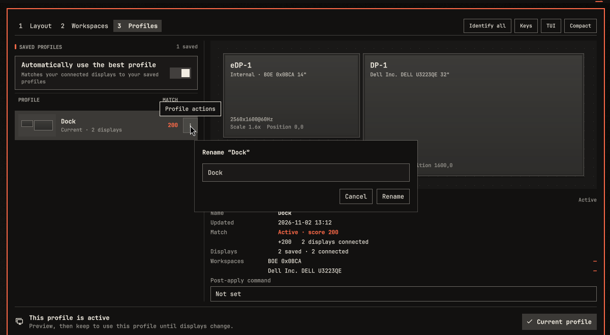

# hyprmoncfg panel 2.13.0

Rename saved profiles and calibrate a 2-in-1's rotation from the panel. Requires hyprmoncfg 1.24.0 or newer; Rename needs [1.27.0](https://github.com/crmne/hyprmoncfg/releases/tag/v1.27.0), and [1.28.0](https://github.com/crmne/hyprmoncfg/releases/tag/v1.28.0) keeps a sideways panel's upright rotation when you leave Auto.

Install or update through Omarchy's plugin manager: [hyprmoncfg panel](https://github.com/crmne/omarchy-hyprmoncfg).

*Real panel in real Quickshell with synthetic monitors, in an isolated display.*

## New

- **Rename a profile.** Choose **Rename…** from a saved profile's actions. It moves the profile's files and changes nothing on your displays. Requested by @shyam-unnithan in [hyprmoncfg #100](https://github.com/crmne/hyprmoncfg/issues/100).
- **Calibrate automatic rotation.** With a panel on Auto, hold the device upright and press **Calibrate**. Requested by @xpusostomos in [hyprmoncfg #90](https://github.com/crmne/hyprmoncfg/issues/90).

## What's tested

277 Node tests pass, along with the QML suites. Rename ran end to end in real Quickshell against a real daemon on synthetic monitors. Calibrate was not run: it needs an orientation sensor, so its button has only the suite's source check. The new strings in other languages have had no native-speaker review.
