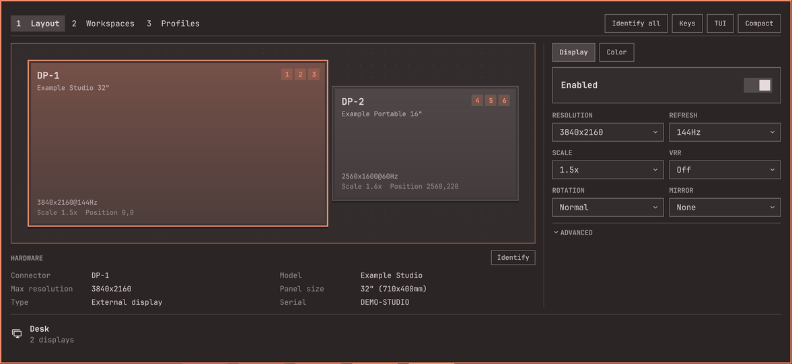

# hyprmoncfg panel 2.14.0

The expanded panel gets much calmer: it shows your settings' values instead of every option at once. Requires hyprmoncfg 1.24.0 or newer.

Install or update through Omarchy's plugin manager: [hyprmoncfg panel](https://github.com/crmne/omarchy-hyprmoncfg).

*Real panel in real Quickshell with synthetic monitors, in an isolated display.*

## New

- **Selectors instead of rows of buttons.** Refresh, Scale, VRR, Rotation and the other settings with three or more choices are now selectors. The Display tab goes from 26 controls to 8, and the Color tab from 20 to 4. Nothing was removed.
- **One Advanced row per tab.** Flipped, Position and Place beside live there on Display, and calibration and capability overrides on Color. Closed, it names any hidden value that isn't at its default, so nothing is secretly set. It never opens by itself, and opening it doesn't move the panel.
- **Scale leads with the usual choices.** Its list starts with the presets, then every other sharp scale, then Custom….
- **Lock and Calibrate on the keyboard.** On Auto they have their own stops, and Lock stays outside Advanced.

## Changed

- **Enter opens a selector's list** on Refresh, VRR, Rotation, SDR EOTF and the capability rows. `h` and `l` still step the value, and stop at the ends.
- **Place beside** is now a selector. Alt+arrows remains the fast way.

## What's tested

281 Node tests pass, along with the QML suites. The panel ran in real Quickshell with synthetic monitors, on Omarchy's current branch in English, German and Arabic, and on 4.0.6 in English: Scale's list, Advanced and keyboard stepping. Not tested: real monitors, text size 20, the Lock and Calibrate rows, which need an orientation sensor, and Place beside's list. New strings in other languages have had no native-speaker review.
